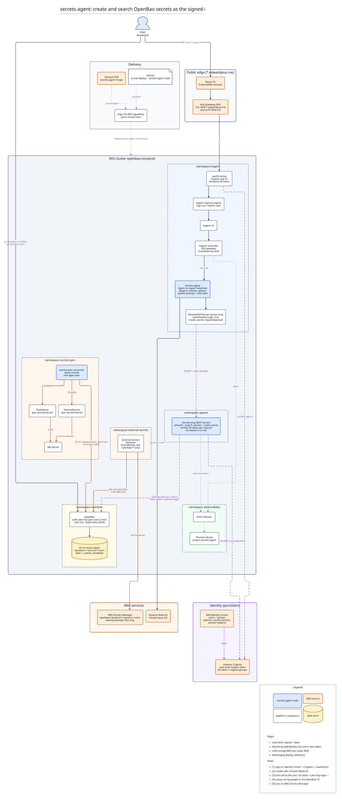

# Architecture



Source: [`architecture.d2`](architecture.d2). Re-render after a change:

```bash
d2 --layout elk docs/architecture.d2 docs/architecture.svg
d2 --layout elk docs/architecture.d2 docs/architecture.png
```

Blue boxes are this repo's code: the kagent agent definition (deployed from ai-hub), the
`secrets-mcp` server and the `secrets-sync` reconciler. Everything else is the AI Hub
platform (openbao-platform) or AWS.

## Flows

| # | Flow | Notes |
|---|---|---|
| 1 | **Sign in.** Browser → Route 53 → ALB (allowed IPs only) → oauth2-proxy → Cognito → IAM Identity Center (SAML). | oauth2-proxy forwards the user's Cognito ID token on every request. |
| 2 | **Model calls.** secrets-agent (kagent runtime on Agent Substrate) → Amazon Bedrock. | The model never sees a secret value: no tool takes or returns one. |
| 3 | **Tool call as the user.** kagent's RemoteMCPServer forwards the user's ID token (`tokenPassthrough`) to `secrets-mcp`, which verifies it against Cognito's JWKS and logs in to OpenBao `auth/jwt-mcp` for that user's own 5-minute batch token. OpenBao policies (from the user's Identity Center groups) decide what happens. | `create_secret` waits for the user's Approve in kagent (`requireApproval`, SA-004). Writes are create-only (`cas=0`); search reads metadata only (spec 003). |
| 4 | **Values set by people.** Keys created as "set in the UI" hold a placeholder; the user sets them in the OpenBao UI (OIDC sign-in). | |
| 5 | **Sync to AWS.** Every minute the `secrets-sync` reconciler (role `apps-sync`) lists `apps/` metadata, and for each secret with `sync_aws = true` and every value set, applies an ExternalSecret and a PushSecret. ESO reads the value (role `apps-eso`) and pushes it to Secrets Manager under `openbao/...`; the reconciler writes `sync_status` back. | The reconciler has no AWS rights; ESO's role is limited to `openbao/*`, and each AWS copy carries a policy that only ESO may change it (SA-002, openbao-platform D-27). |

Telemetry: `secrets-mcp` and kagent send spans (no values, a hashed user id) to the OTel
Collector and Phoenix, project `secrets-agent`. Delivery: Argo CD syncs ai-hub `main`
(Agent, RemoteMCPServer, the `secrets-mcp` Deployment); images come from ECR. The
reconciler is deployed by openbao-platform layer 60.

## Who may do what

| Identity Center group | Through the agent | In the OpenBao UI |
|---|---|---|
| `openbao-admins` | create in dev, staging, prod; search | everything under `apps/` |
| `openbao-secrets-writers` | create in dev, staging; search | create and edit values in dev, staging |
| `openbao-secrets-readers` | search | browse names and metadata |
| others | nothing | nothing |

Decisions: `product/decisions.md` (SA-001 to SA-004); platform side: openbao-platform
`docs/DECISIONS.md` D-19, D-25, D-27.
